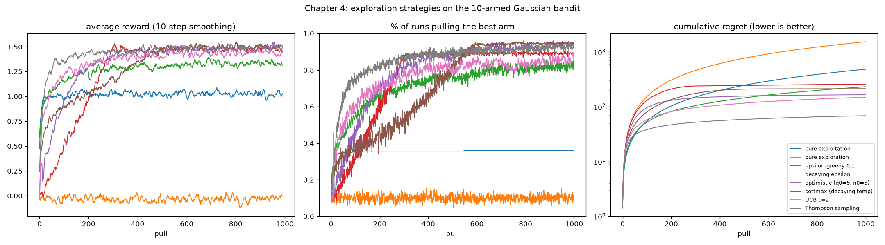

# Chapter 4: Exploration vs exploitation

**Book chapter:** *Balancing the gathering and use of information*
**Run:** `flyte run pipeline.py ch04_bandits`  ·  locally `python -m ch04_bandits.bandits`

## The core idea

Strip away states entirely and one problem is left: you do not know which action is best, and the only way to find out is to try things, which costs you reward you could have collected by sticking with what you know. That is the **multi-armed bandit**.

```
    arm:    0     1     2     3     4     5     6     7     8     9
          ┌───┐ ┌───┐ ┌───┐ ┌───┐ ┌───┐ ┌───┐ ┌───┐ ┌───┐ ┌───┐ ┌───┐
          │ ? │ │ ? │ │ ? │ │ ? │ │ ? │ │ ? │ │ ? │ │ ? │ │ ? │ │ ? │
          └───┘ └───┘ └───┘ └───┘ └───┘ └───┘ └───┘ └───┘ └───┘ └───┘
    each pays N(μ_k, 1), with μ_k ~ N(0, 1) hidden from the agent
```

The score is **regret**: how much reward you gave up compared to pulling the best arm every time. `regret = Σ_t (μ* - μ_{a_t})`. Pure exploration has regret that grows linearly forever; a good strategy's regret flattens out once it has figured out the best arm.

Every strategy keeps the same estimate, a running average `Q(a) += (r - Q(a)) / N(a)` (Q(a) is the estimated payout of arm a, N(a) how many times it has been pulled), and differs only in how it picks the next arm:

Acronyms and symbols are all in the [glossary](../README.md#glossary).


| Strategy | How it picks | Explores by |
|---|---|---|
| pure exploitation | `argmax Q` | never: stuck with whatever looked good first |
| pure exploration | uniform random | always: never uses what it learned |
| ε-greedy (epsilon-greedy) | random with prob ε, else `argmax Q` | a fixed coin flip |
| decaying ε | same, ε shrinks from 1 to 0.01 | lots early, little late |
| optimistic init | `argmax Q`, with Q starting at 5 | being disappointed into trying every arm |
| softmax | sample ∝ `exp(Q / τ)`, temperature τ (tau) shrinking | preferring good arms *in proportion* |
| UCB (upper confidence bound) | `argmax Q + c·sqrt(ln t / N)` | a bonus for arms it is unsure about |
| Thompson sampling | draw from each arm's posterior, play the best draw | its own uncertainty, directly |

## How the code does it

[`bandits.py`](bandits.py) runs 2000 independent bandits **in lockstep**: `Q` and `N` are `(2000, 10)` arrays, and each strategy is a function that takes them and returns 2000 arm choices at once. That makes a full 8-strategy × 2000-run × 1000-pull experiment take about 2 seconds of numpy.

Three details that matter:

- `greedy()` adds tiny random noise before `argmax`. Without it, ties (every arm at Q = 0 on pull one) always resolve to arm 0, which quietly biases every greedy strategy.
- Optimistic initialization sets both `Q = 5` and `N = 5`. Setting only Q does nothing with sample averages: the first real reward overwrites it completely.
- Thompson sampling uses the Gaussian posterior for a N(0, 1) prior and known noise of 1: mean `Q·N/(N+1)`, std `1/sqrt(N+1)`.

## What it shows

```
2000 bandits x 10 arms x 1000 pulls, best possible average reward 1.535

                      avg reward   best arm (last 100)   total regret
  pure exploitation      1.009          34.6%               525.5
   pure exploration      0.004          10.0%              1531.1
 epsilon-greedy 0.1      1.305          80.7%               230.4
   decaying epsilon      1.276          88.2%               258.5
 optimistic q0=5,n0=5    1.371          93.4%               165.2
 softmax (decaying)      1.325          94.5%               210.3
            UCB c=2      1.386          84.8%               148.7
  Thompson sampling      1.466          91.3%                68.3
```

- **Pure exploitation** locks onto the best arm in only about a third of runs and never recovers in the rest.
- **ε-greedy** finds the best arm but keeps paying for random pulls forever: its regret curve never flattens.
- **Thompson sampling** wins by a wide margin, at less than half of UCB's regret. It explores exactly as much as its uncertainty warrants, with no schedule to tune.
- "Best arm %" and "regret" disagree on purpose: softmax pulls the best arm most often at the end, but it got there slowly and paid for it early.

## In the report

**Three strategies playing the same 10 machines, pull by pull**: ε-greedy, UCB and Thompson sampling. Each frame shows every machine's estimate against its secret average, the pull count, and UCB's bonus or Thompson's imagined payout, with a caption explaining why that machine was pulled and how the estimate changed. Then the 2,000-bandit averages and the table above.


