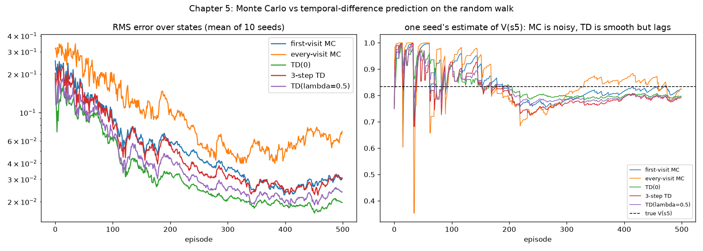

# Chapter 5: Estimating values from experience

**Book chapter:** *Evaluating agents' behaviours*
**Run:** `flyte run pipeline.py ch05_prediction`  ·  locally `python -m ch05_prediction.prediction`

## The core idea

Chapter 3 computed V^π from the transition table. Now the table is gone: the agent only gets to watch episodes. The question is still "what is this policy worth in each state?", but it has to be answered from samples.

There are two families. **Monte Carlo (MC)** methods wait for the episode to end and learn from the actual return. **Temporal difference (TD)** methods learn after every step, from the *difference* between the current estimate and a slightly better one a step later in time. In between sit n-step TD and TD(λ) (lambda), which blend the two.

Acronyms and symbols are all in the [glossary](../README.md#glossary).

The methods differ in **what they move V(s) towards** (the target):

```
            time ──►   s_t ──r1──► s_t+1 ──r2──► s_t+2 ──r3──► ... ──► end

  Monte Carlo   target = r1 + γ r2 + γ² r3 + ...           (the real return; wait for the end)
  TD(0)         target = r1 + γ V(s_t+1)                   (one real reward, then a guess)
  n-step TD     target = r1 + ... + γⁿ⁻¹ rn + γⁿ V(s_t+n)  (n real rewards, then a guess)
  TD(λ)         target = a (1-λ)λⁿ⁻¹-weighted mix of every n-step target

  update:       V(s_t) ← V(s_t) + α · (target - V(s_t))     α (alpha) = step size
```

This is the **bias/variance trade-off** in its purest form:

- **MC** uses only real rewards, so it is unbiased, but a whole episode of coin flips makes each return noisy (high variance).
- **TD** uses its own current guess for everything past one step. That guess is wrong at first (biased), but it only depends on one random step (low variance).
- **n-step** and **TD(λ)** slide between the two.

## The world

The random walk: five cells, a fair coin moves you left or right regardless of the action, +1 for leaving on the right. The true values are known exactly, which makes it a perfect test:

```
    H  [1]  [2]  [3]  [4]  [5]  G
       1/6  2/6  3/6  4/6  5/6         true V (start in the middle)
```

## How the code does it

[`prediction.py`](prediction.py) generates one batch of episodes per seed and feeds **the same episodes** to every method, so differences come from the method and not the luck of the draw.

- `mc_update` walks the episode backwards to compute each return, then applies first-visit (only the earliest visit to a state) or every-visit updates.
- `ntd_update` builds each n-step target from the stored trajectory. Doing this after the episode gives the same result as doing it online here, because the random-walk policy never reads V.
- `td_lambda_update` keeps an eligibility trace `E`: each visit bumps `E[s]`, every step decays all of `E` by `γλ`, and one TD error updates every state in proportion to its trace. That is TD(λ) without ever forming the n-step targets.
- The step size decays exponentially from 0.5 to 0.01 over the first half of training (`decay_schedule`, reused by chapter 6).

## What it shows

```
RMS (root mean square) error vs the true values, mean of 100 seeds, same episodes for every method

                   ep 10    ep 50    ep 100   ep 500
  first-visit MC   0.224    0.141    0.097    0.028
  every-visit MC   0.308    0.220    0.172    0.049
           TD(0)   0.137    0.099    0.066    0.020
       3-step TD   0.198    0.137    0.090    0.027
  TD(lambda=0.5)   0.161    0.111    0.074    0.022
```

- **TD(0) wins at every checkpoint here.** On this short, noisy walk with a large early step size, low variance matters more than low bias.
- **Every-visit MC is worst.** A state visited five times in one episode gets five updates from five strongly correlated returns, each at a large α.
- The ordering of the n-step family follows n: the further a method looks before bootstrapping, the closer it behaves to MC.

## In the report

1. **One game, learned two ways.** The same game is narrated for TD and for MC side by side. TD's panel writes out each update ("target = 0 + 44% = 44%; it was 54%, so move halfway: 54% → 49%"). MC waits, then pushes every visited square towards the final score.
2. **Hundreds of games**: every method's guesses next to the true answer, game by game, then the error chart and table.


