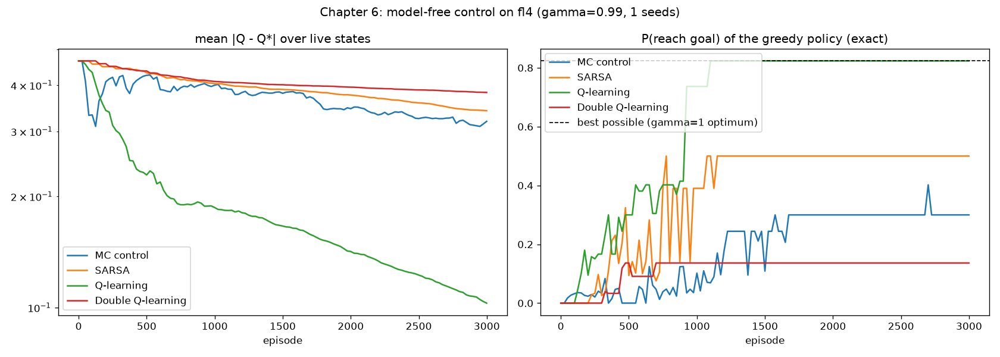

# Chapter 6: Learning to act

**Book chapter:** *Improving agents' behaviours*
**Run:** `flyte run pipeline.py ch06_control`  ·  locally `python -m ch06_control.control` (frozen lake 4x4, 10,000 games; `--env sws --episodes 3000` for the slippery walk)

## The core idea

Chapter 5 estimated the value of a *fixed* policy. **Control** closes the loop: estimate action values Q(s, a), act mostly greedily on them, and let better estimates make a better policy, which makes better data, which makes better estimates. This is **generalized policy iteration**, chapter 3's loop without the model:

```
           evaluate (one sample at a time)
       ┌────────────────────────────────────┐
       ▼                                    │
     Q(s,a)                              policy π
       │                                    ▲
       └────────────────────────────────────┘
           improve (ε-greedy on Q)
```

Why Q and not V? Without the model, `V(s)` cannot tell you which action to take (you would need `P` to look one step ahead). `Q(s, a)` has the lookahead built in: `π(s) = argmax_a Q(s, a)`.

The four classics differ only in the target. MC is Monte Carlo (chapter 5). **SARSA** is named after the five things its update uses: **S**tate, **A**ction, **R**eward, next **S**tate, next **A**ction, i.e. (s, a, r, s', a'). The "Q" in Q-learning is the action-value table Q(s, a).

Acronyms and symbols are all in the [glossary](../README.md#glossary).


```
  MC control   Q(s,a) ← G                                 the real return, after the episode
  SARSA        Q(s,a) ← r + γ Q(s', a')                   a' = the action it actually takes next
  Q-learning   Q(s,a) ← r + γ max_a' Q(s', a')            the best next action, whatever it does
  Double Q     Q_A(s,a) ← r + γ Q_B(s', argmax Q_A(s',·))  one table picks, the other scores
```

**On-policy vs off-policy** is the big idea. SARSA and MC learn the value of the policy they are *running*, exploration included. Q-learning learns the value of the *greedy* policy while running an exploratory one. **Double Q** fixes Q-learning's habit of overestimating: `max` over noisy estimates is biased upward, so using a second table to score the chosen action removes the bias.

## How the code does it

[`control.py`](control.py) has one function per algorithm, all with the same signature, and `train_and_score()` that every learner (chapter 7's too) runs through:

- ε decays from 1.0 to 0.1 over 90% of training, α from 0.5 to 0.01 over the first half.
- Every 25 episodes it records the error against chapter 3's `Q*`, and the **exact** success probability of the current greedy policy (chapter 3's policy evaluation on the true model; no noisy rollouts).
- It keeps a copy of Q at each checkpoint, which the report turns into a slider of the greedy policy forming.
- `eps_greedy()` breaks ties at random. With an all-zero Q, `argmax` would always say "left".

## What it shows

On **slippery walk seven** every learner finds the optimal "always right" policy (98.8%). On **frozen lake 4x4** (10,000 episodes, 5 seeds) they diverge:

```
                    greedy policy reaches goal    mean |Q - Q*|
  MC control               67.5%                     0.215
  SARSA                    78.0%                     0.220
  Q-learning               82.4%   (= optimal)       0.013
  Double Q-learning        78.0%                     0.080
```

- **MC and SARSA are on-policy**, and ε never drops below 0.1, so they learn what the *exploring* policy is worth. On a lake full of holes, 10% random moves are expensive, so their Q sits well below `Q*`, and their greedy policies are tuned for an agent that sometimes stumbles.
- **Q-learning learns `Q*` itself** from the same kind of experience, which is the whole point of being off-policy.
- **Double Q is slower here**: every sample updates only one of its two tables, so each learns from half the data. What it buys, removing the upward bias of `max`, is small here: rewards are exactly 0 or 1, so Q-learning's overestimation stays mild. It pays off when rewards themselves are noisy.

## In the report

1. **One game of Q-learning, every update shown.** The panel shows the agent's notes for its square, the explore-or-exploit coin flip, what the ice did, and the update: `target = 0 + 0.99 × 0.41`, the error, and the new note. The numbers on the board change as it learns.
2. **Watch it learn.** Its plan after 1, 100, 500 and 2,000 games and at the end, all replayed with the same dice, each titled with the plan's true chance of winning (0% → 0% → ~30% → 82%).
3. **Four learners, four plans**, scored exactly, next to the true best plan.
4. **Why they differ**: a table of what each learner moves its notes towards, plus the charts.


