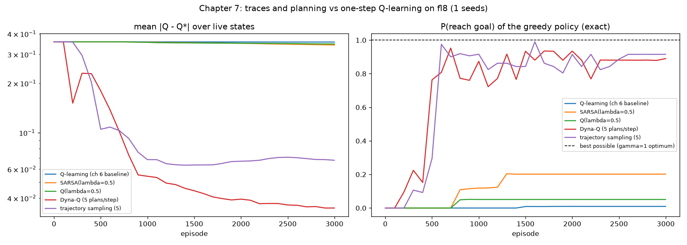

# Chapter 7: More learning per step

**Book chapter:** *Achieving goals more effectively and efficiently*
**Run:** `flyte run pipeline.py ch07_traces_dyna`  ·  locally `python -m ch07_traces_dyna.traces_dyna`

## The core idea

One-step Q-learning is wasteful. When the agent finally reaches the goal on the 8x8 lake, only the very last (state, action) learns anything; the dozens of steps that led there have to wait for that value to trickle back one episode at a time. This chapter gives two ways to spread each experience further: **eligibility traces** (the λ in SARSA(λ) and Q(λ), read "lambda") and **planning with a learned model** (Dyna-Q; "Dyna" is the name Rich Sutton gave the architecture, not an acronym).

Acronyms and symbols are all in the [glossary](../README.md#glossary).

### 1. Eligibility traces: credit the whole recent path

```
   path:   s0 ──► s1 ──► s2 ──► s3 ──► s4 ──► GOAL (+1)
   trace:  .06    .12    .25    .5     1.0                 (γλ = 0.5 per step back)

   one TD error δ at the end updates every cell on the path:  Q += α · δ · E
```

Every visit marks `E[s, a] = 1` (a *replacing* trace), and every step multiplies all marks by `γλ`. One TD (temporal difference) error δ (delta, target minus estimate, from chapter 5) then updates the whole path, scaled by how recently each step happened. λ = 0 is plain one-step TD; λ = 1 is Monte Carlo.

- **SARSA(λ)**: on-policy, traces follow whatever the agent did.
- **Watkins's Q(λ)**: off-policy, so the trace is *cut* the moment the agent takes an exploratory action. After a random move, earlier steps are no longer "what the greedy policy would have done", so they cannot be credited through it.

### 2. Learn a model, then practise in your head

```
       real step                  planning steps (n per real step)
   ┌───────────────┐           ┌─────────────────────────────────┐
   │ act in world  │──(s,a,r,s')──► model: counts of s' given (s,a) │
   │ Q-learning    │           │ sample (s,a) → imagine r, s'     │
   │   update      │           │ Q-learning update on the dream   │
   └───────────────┘           └─────────────────────────────────┘
```

- **Dyna-Q** records every transition it sees, then after each real step replays `n` imagined transitions from random (state, action) pairs it has tried before.
- **Trajectory sampling** plans from *where the agent is now*, following its greedy policy through the model, so the imagined experience is concentrated on the states it is actually going to visit.

## How the code does it

[`traces_dyna.py`](traces_dyna.py) plugs each method into chapter 6's `train_and_score`, so every learner sees the same step-size and ε schedules and is scored the same way: the exact success probability of its greedy policy.

- The traces are a `(states, actions)` array updated with one vectorised `Q += α δ E` per step.
- `Model` keeps counts `N[s, a, s']` and reward sums. Sampling from the model is sampling `s'` in proportion to how often it was seen, so on ice the model learns the 1/3 slips on its own.
- In trajectory sampling, the greedy choice breaks ties at random. With an all-zero Q, a plain `argmax` sends every imagined rollout "left" into the same wall, and planning does nothing. (That bug was real: it made trajectory sampling the worst method on the first run.)

## What it shows

Frozen lake 8x8, 10,000 episodes, 3 seeds, λ = 0.5, 5 planning steps per real step. With unlimited time the best possible policy reaches the goal **100%** of the time (given unlimited steps, some policy never has to risk a hole); learners with γ = 0.99 trade a little of that safety for speed.

```
                                 greedy policy reaches goal   mean |Q - Q*|   first reaches 90%
   Q-learning (chapter 6)              86.1%                     0.094            episode 6100*
   SARSA(λ=0.5)                        94.2%                     0.240            episode 4300
   Q(λ=0.5)                            88.8%                     0.078            episode 2500
   Dyna-Q (5 plans/step)               91.0%                     0.012            episode 3700
   trajectory sampling (5)             89.2%                     0.041            episode 2700

   * the 3-seed average touches 90% at episode 6100, then settles at 86%
```

- **Planning makes Q accurate.** Dyna-Q's error against `Q*` is 8x lower than Q-learning's after the same real experience: every real step becomes six updates.
- **Traces and trajectory sampling make it fast.** Q(λ) and trajectory sampling reach a near-optimal policy first; both push value back along the path the agent actually takes.
- **SARSA(λ) learns the best policy but the "wrong" Q.** Same on-policy story as chapter 6: its values are for the exploring agent, but on a big lake the cautious policy that comes out of that is a good one.
- With 3,000 episodes nothing converged yet, and the gap between methods was much wider: Q-learning at 14%, Dyna-Q at 66%. That is the early-training picture the chapter is about. Try `--episodes 3000` to see it.

## In the report

1. **Memory traces, glowing.** A narrated SARSA(λ) game on the 4x4 lake. Each move leaves a yellow glow that fades by γλ. When the agent finally wins, the surprise (δ = +0.83) visibly spreads back along the glowing path, and the panel lists every note it changed.
2. **Imagination.** A narrated Dyna-Q game: after each real step, five 💭 imagined moves drawn from its own tallies of where moves land, with each note's change.
3. **The race on the 8x8 lake**: a learning reel per method (100, 1,000, 3,000 games, end).
4. Final plans, the charts and the table.


