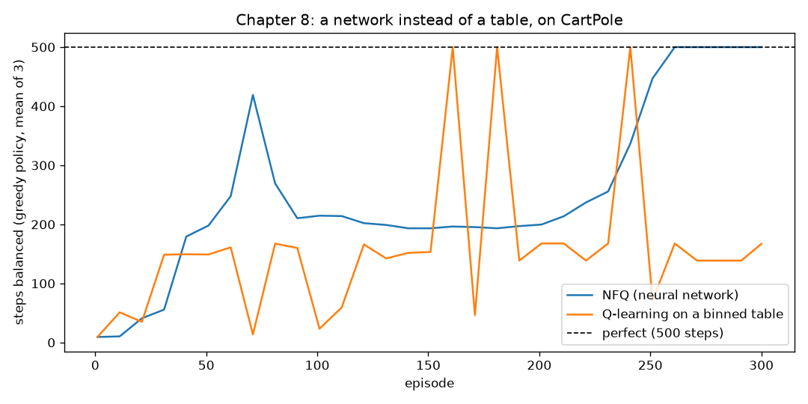

# Chapter 8: A network instead of a table

**Book chapter:** *Introduction to value-based deep reinforcement learning*
**Run:** `flyte run pipeline.py ch08_nfq`  ·  locally `python -m ch08_nfq.nfq`

Acronyms and symbols are all in the [glossary](../README.md#glossary).

## The core idea

Every chapter so far kept a **table**: one note Q(s, a) per square and move. That works on a 4x4 lake. It does not work when the state is a set of real numbers, because there are infinitely many states and the agent will never visit the same one twice.

**CartPole** is the classic example. A cart on a short track balances a pole hinged on top; every step the agent pushes left or right and scores +1 while the pole stays up (500 steps is a perfect game). The agent sees four numbers: cart position, cart speed, pole angle, pole spin.

```
            |  pole (angle, spin)
            |
        ┌───┴───┐
  ←push │ cart  │ push→        state = [position, speed, angle, spin]
  ══════╧═══════╧══════        4 real numbers, not a square on a grid
```

Two ways to keep using chapter 6's Q-learning:

| Approach | What it does | Weakness |
|---|---|---|
| **Binned table** | chop each number into a few bins (here 3 × 3 × 8 × 8 = 576 cells) | every cell must be visited; nothing learned in one cell helps its neighbour |
| **NFQ** (neural fitted Q iteration) | a neural network takes the 4 numbers and outputs Q(push ←) and Q(push →) | the targets come from the network it is training, so it wobbles |

The network wins because it **generalizes**: "leaning 4° right" and "leaning 5° right" are nearly the same input, so learning about one improves its guesses for the other.

## How the code does it

[`nfq.py`](nfq.py):

```
QNet:  4 inputs → 32 ReLU → 32 ReLU → 2 outputs (one Q-value per push)

after every game:
    add its moves to the dataset (the most recent 20,000)
    targets = r + γ · max_a' Q(s', a')      computed ONCE, from the current network
    20 full-batch Adam steps fitting Q(s, a) to those fixed targets
```

- **Targets are frozen during each fit.** Recomputing them every epoch, so the network chases a target that moves with every step it takes, blew the Q-values up to about 1,800 when the honest ceiling with γ = 0.99 is 1 / (1 − γ) = 100. Freezing them per fit is what fitted Q iteration actually specifies, and it brought them back to roughly 115 to 120.
- **Time limit is not failure.** When the 500-step limit cuts a game short, the agent keeps bootstrapping from the next state; only a real fall gets a target of zero future reward.
- **ε decays** from 1 to 0.05 over the first half of training, so the agent explores early and reaches long-balance states later.
- The binned baseline is chapter 6's Q-learning unchanged, on `np.digitize`d state.

## What it shows

Seed 2, 300 games each:

```
                     last third of training (average steps balanced)   final
  NFQ (network)                 381                                     500
  binned table                  178                                     167    (only 182 of 576 cells ever visited)
```

- The table occasionally lands a lucky 500 but cannot hold it. The network climbs to a steady 500.
- **NFQ wobbles.** In other seeds it reached 500, then dropped to 200 for a stretch. The targets come from the same network being trained, so every fit moves the goalposts. Chapter 9's DQN (target network, replay buffer) exists to fix this.
- **It is over-optimistic.** Its Q-values sit around 115 to 120, above the honest maximum of 100. Taking the max of its own noisy estimates rounds up every time. That is the bias Double DQN removes.

## In the report

1. **Why the table stops working**: cells vs visits, and the learning curves.
2. **Inside the network, while it plays.** The game on a canvas next to the network: the 4 inputs with their live values, all 64 hidden units lighting up with their activation on each frame, the strongest weights as orange (+) and blue (−) lines, and both Q-values, with a sentence explaining each choice.
3. **The notes as a picture.** A heatmap slider of the network's preferred push over pole angle × pole spin, through training: a diagonal boundary forms, mostly following the spin (push the way the pole is falling), shifted by the angle.
4. **Watch it learn**: the untrained network through to the final one, all from the same starting position.
5. **The NFQ loop**, and why it wobbles.


