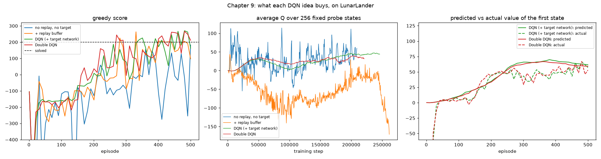

# Chapter 9: Making deep Q-learning stable

**Book chapter:** *More stable value-based methods*
**Run:** `flyte run pipeline.py ch09_dqn`  ·  locally `python -m ch09_dqn.dqn` (about a minute and a half on 4 cores)

Acronyms and symbols are all in the [glossary](../README.md#glossary).

## The core idea

Chapter 8's NFQ wobbled. Two things fight any network trained on Q-learning targets:

1. **Correlated data.** Consecutive moves are nearly identical: the same two seconds of the same flight. A batch of them teaches one narrow lesson, and the next batch overwrites it.
2. **A moving target.** The target `r + γ · max Q(s', ·)` comes from the very network being trained, so every update moves the goalposts.

**DQN** (deep Q-network) adds one fix for each, and **Double DQN** fixes a bias the `max` leaves behind:

```
replay buffer     keep the last 100,000 moves; every 4 steps, train on 64 picked at random
target network    compute targets with a frozen copy of the network, refreshed every 1,000 steps
Double DQN        target = r + γ · Q_frozen(s', argmax_a Q_online(s', a))
                  the online network picks the next move, the frozen copy scores it
```

Why Double: the `max` over noisy estimates always picks the luckiest one, so plain DQN's values round up. Letting one network choose and a different one judge breaks that link.

## The world: LunarLander

Not one of the book's examples: a lander starts high above the moon with a random push and has to settle on the pad between two flags. It has four actions (do nothing, left engine, main engine, right engine) and sees eight numbers: position, velocity, tilt, spin, and leg contacts. Moving towards the pad and slowing down earns points, each leg touching down +10, crashing −100, coming to rest +100. **200 = solved**: a clean landing.

## How the code does it

[`dqn.py`](dqn.py) trains **four learners with the same network (8 → 128 → 128 → 4) and the same budget**, each adding one idea:

| learner | trains on | targets from |
|---|---|---|
| no replay, no target | the last 64 moves, in order | the network being trained |
| + replay buffer | 64 random moves from the last 100k | the network being trained |
| DQN | 64 random moves | a frozen copy, refreshed every 1,000 steps |
| Double DQN | 64 random moves | online network picks, frozen copy scores |

- The buffer is a NumPy ring buffer. A `deque` was 4x slower, because random access into it is O(n).
- The four learners train **in parallel processes**, one per core, since they're independent.
- Two diagnostics are recorded during training:
  - **Probe states:** 256 fixed states from random flights, asked of every learner every 500 steps, to watch how its opinions move.
  - **Optimism:** the predicted value of each evaluation flight's first state against the discounted score it actually achieved from there.

## What it shows

Seed 0, 500 games each, average greedy score over the last third of training:

```
  no replay, no target       3      (never stable: scores swing from -250 to +180)
  + replay buffer          153
  DQN (+ target network)   186
  Double DQN               182      (final evaluation 212: a clean landing)
```

- **The replay buffer is the biggest single fix** here: 3 → 153.
- **The target network shows up most clearly in the probe chart.** Without it, the network's average opinion jumps around by ±50 (no replay) or drifts down to −150 and collapses at the end (replay only). With it, opinions move smoothly.
- **Double DQN is level with DQN on score.** Its benefit is honesty: its predicted values stay closer to what it actually achieves. The report gives the measured gap for each.

## In the report

1. **The four learners' curves**, the probe chart and the predicted-vs-actual chart, each with how to read it.
2. **The replay buffer, pictured.** One training batch plotted over the positions of 60 flights: without replay, it's 64 points in a tight line from one stretch of one flight; with replay, they're spread across the whole sky.
3. **The target network**, as the three target formulas side by side, plus the measured over-optimism.
4. **A flight with the network's thinking.** The lander drawn on a canvas with engine flames and legs that turn green on touchdown, next to the Q-value of each action (the chosen one in green) and the 128 units of the last hidden layer lighting up frame by frame.
5. **Watch it learn**: Double DQN after 25, 100, 200, 300 and 500 games, on the same terrain.


