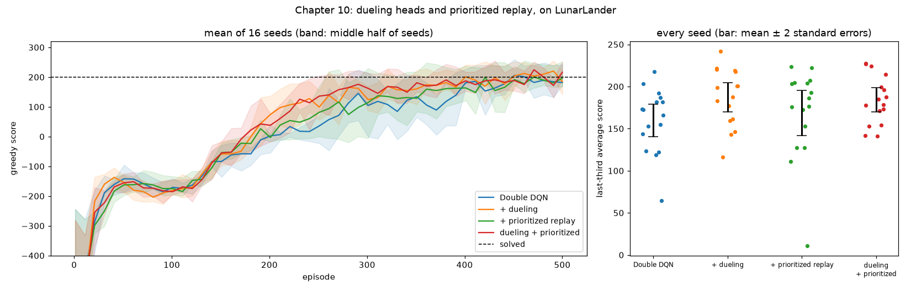

# Chapter 10: Learning more from the same experience

**Book chapter:** *Sample-efficient value-based methods*
**Run:** `flyte run pipeline.py ch10_dueling_per`  ·  locally `python -m ch10_dueling_per.dueling_per` (64 training runs; about 12 minutes on 20 cores)

Acronyms and symbols are all in the [glossary](../README.md#glossary).

## The core idea

Chapter 9's Double DQN can land the lander. This chapter asks **how many games it needs**, which is *sample efficiency*. Two ideas, each changing one part of the learner:

**1. The dueling network: ask two questions instead of one.**

```
chapter 9:   state → body → Q(s, nothing), Q(s, left), Q(s, main), Q(s, right)

dueling:     state → body ─┬→ V(s)       how good is this moment, whatever I do?
                           └→ A(s, a)    how much better is each action than average?

             Q(s, a) = V(s) + A(s, a) − mean_a A(s, a)
```

In most moments the actions barely differ. Drifting high above the pad, any engine is about as good as any other. A plain Q network still has to learn "this moment is good" separately for every action. The dueling network learns it once, in V, and every update teaches V something. Subtracting the mean of A pins down the split; without it, "+5 to V and −5 to every A" gives the same Q and the two heads drift.

**2. Prioritized experience replay (PER): study the surprising moments.**

Uniform replay gives a rare crash the same attention as a thousand frames of drifting. PER replays each memory in proportion to how wrong the network was about it, `(|TD error| + ε)^α` with α = 0.6, then multiplies each update by an **importance-sampling weight** `(N · P(i))^−β` so that oversampling the dramatic moments doesn't distort the average lesson. β is annealed from 0.4 to 1.

## How the code does it

[`dueling_per.py`](dueling_per.py) reuses chapter 9's world, ring buffer and evaluation. It trains four learners, all with Double DQN targets:

| learner | network | replay |
|---|---|---|
| Double DQN (chapter 9) | 8 → 128 → 128 → 4 | uniform |
| + dueling | body → V head + A head | uniform |
| + prioritized replay | 8 → 128 → 128 → 4 | prioritized |
| dueling + prioritized | body → V head + A head | prioritized |

- **16 seeds per learner, 64 runs** in parallel processes, sized to the CPU quota the task really has. A pod reports all 20 host cores, but its cgroup quota is what it can use.
- **Verdicts are judged against the noise.** A learner is "clearly better" only if its gap to the baseline beats two standard errors of the difference.
- `PrioritizedMemory` samples by cumulative sum plus binary search, which is O(N) per batch. That's fine at 100k memories; at millions you would use a sum-tree. New memories get the current maximum priority, so each is replayed at least once soon.

**Why 16 seeds:** a single seed of these four learners ranked the plain baseline **first**. The spread between seeds of the *same* learner is often bigger than the gap between learners.

## What it shows

16 seeds each, 500 games:

```
                          last-third average     steady 100+ (median)   verdict
  Double DQN                160 ± 10              episode 291            baseline
  + dueling                 187 ±  9              episode 221            clearly better (+27, noise ±26)
  + prioritized replay      169 ± 14              episode 281            no clear difference (+9, noise ±33)
  dueling + prioritized     184 ±  7              episode 241            clearly better (+25, noise ±24)
```

- **Dueling is the change that matters here.** It reaches a steady 100 about **70 games sooner** and ends higher, though only just past the noise bar.
- **PER does what it says, but it didn't measurably help.** Crash and rest moments (±100 points) are 0.15% of its memories but get 5% of its replays, about 30× their share. All 50 of its most-replayed memories are such moments. LunarLander simply produces enough landings that uniform replay sees plenty by the time it matters. PER pays off when important moments are rare *and* hard.

## In the report

1. **Four learners over 16 seeds**: mean curves with a band covering the middle half of seeds, every seed as a dot, and the verdict table.
2. **The dueling network flying**: the lander next to a live **V meter** ("how good is this moment?") and **A bars** centred on zero ("how much better is each action?"). High up the A bars are short; near the ground they spread.
3. **Where prioritized replay looks**: a map of memories coloured by how often they're replayed, the ten most-replayed (topped by a lander flying off the left edge, replayed 41× as often as average), and the measured share for crash and rest moments.


