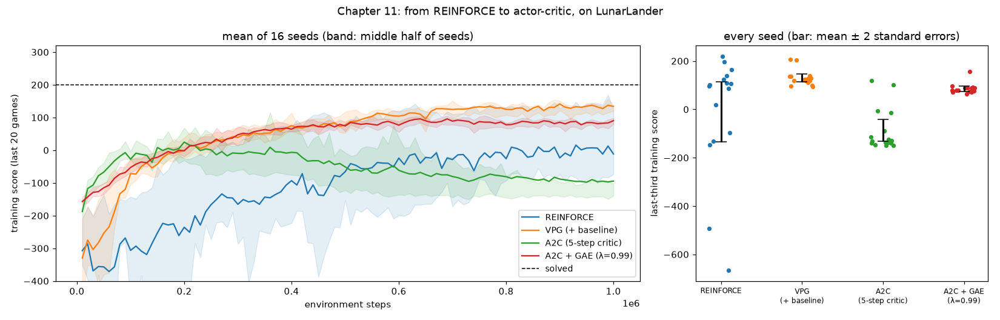

# Chapter 11: Learning the policy directly

**Book chapter:** *Policy-gradient and actor-critic methods*
**Run:** `flyte run pipeline.py ch11_policy_gradient`  ·  locally `python -m ch11_policy_gradient.pg` (84 runs of 1M steps; about 12 minutes on 20 cores)

Acronyms and symbols are all in the [glossary](../README.md#glossary).

## The core idea

Chapters 8 to 10 learned **values**, "how good is each action?", and then picked the best one. Policy-gradient methods learn the **policy** itself: a network that outputs odds for each action, like *main engine 70%, left 20%, nothing 8%, right 2%*, then rolls the dice. Learning means shifting the odds towards moves that worked out:

```
∇ (how well it plays)  ≈  average over moves of  ∇ log π(a | s)  ×  weight
                                                  "make this move     "by how much it
                                                   more likely"        deserved it"
```

The four learners differ only in the **weight**:

```
REINFORCE   weight = G_t                          the rest of the game's score
VPG         weight = G_t − V(s_t)                 better or worse than the critic expected
A2C         weight = r_t + … + γ⁵ V(s_t+5) − V(s_t)    5 real steps, then the critic's guess
GAE         weight = Σ_k (γλ)^k δ_t+k             a λ-blend of every n-step version
```

- **REINFORCE** is unbiased, but one lucky or unlucky ending shoves hundreds of moves the same way.
- **VPG** subtracts a learned **baseline**, the critic's V(s). The expected gradient is the same, but only the *surprise* remains, so it's far less noisy.
- **A2C** (advantage actor-critic) stops waiting for the game to end: 8 landers at once, an update every 5 steps, with the critic standing in for the future. Less noise again, but now the targets are only as good as the critic.
- **GAE** (generalized advantage estimation) is chapter 5's TD(λ) applied to advantages. λ dials between trusting the critic (λ → 0) and trusting real rewards (λ → 1).

## How the code does it

[`pg.py`](pg.py): separate actor and critic networks (8 → 128 → 128, tanh); Adam at 7e-4 with linear decay to 0; actor and critic clipped separately; entropy bonus 0.01. REINFORCE and VPG update after each game. A2C and GAE use an 8-env `gymnasium` vector env with same-step autoreset, bootstrapping from the true final state when the 1,000-step limit cuts a game short.

- 4 learners × **16 seeds** × **1M steps**, plus a **λ dial**: GAE at λ = 0.9, 0.95, 0.98, 0.99 and 1.0, 4 seeds each.
- Verdicts compare each learner with the one above it, and call a difference real only if it beats about two standard errors of the noise between seeds.

## What it shows

```
                          last third (training score)    verdict vs the learner above
  REINFORCE                    −11 ± 62                  baseline (seeds range from −660 to +220)
  VPG (+ baseline)             130 ±  8                  clearly better (+141)
  A2C (5-step critic)          −87 ± 22                  clearly worse (−217)
  A2C + GAE (λ = 0.99)          85 ±  5                  clearly better than A2C (+172)

  GAE λ dial:   0.9 → −2    0.95 → −38    0.98 → +30    0.99 → +71    1.0 → +96
```

- **The baseline is the big win.** VPG is both much better and much more consistent than REINFORCE.
- **5-step A2C collapses**, on every seed: it learns to about +140, then falls to about −120. This took real debugging, so here's what it is *not*:
  - **Not a data bug:** the vector env matches single envs step for step.
  - **Not hyperparameters:** learning rates, advantage normalization, entropy, γ and critic scaling were all tried.
  - **The bisection:** the same code with 32- or 128-step rollouts is stable. With 5 real steps per target, nearly all the signal is the critic's guess, and an immature critic steers the actor off a cliff. It's chapter 5's bias-variance trade-off, live.
- **The λ dial reads the same way:** the more real reward it uses before trusting the critic, the better, *with a critic this young*. A stronger critic shifts the sweet spot towards smaller λ, which is what PPO's safeguards in chapter 12 buy.
- **Policy-gradient agents never fully commit.** Measured over 8 flights, the trained GAE policy keeps about 75% of maximum randomness at every altitude (helped by the entropy bonus). That's one reason these scores sit below chapter 9 and 10's greedy value learners.

## In the report

1. **A policy at work**: a flight with the actor's odds for each action as bars (the dice's pick in green), the critic's V as a meter, and the measured randomness and V by altitude.
2. **Four learners, 16 seeds**: curves, every seed as a dot, the verdict table, the four weight formulas, and the spread of update weights.
3. **Why A2C failed: the λ dial**: score against how far ahead each variant looks before trusting the critic.
4. **Watch it learn**: GAE's policy at points through training, on the same terrain.


