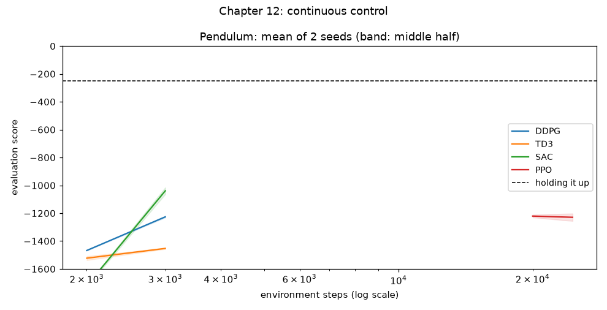

# Chapter 12: Continuous control

**Book chapter:** *Advanced actor-critic methods*
**Run:** `flyte run pipeline.py ch12_actor_critic`  ·  locally `python -m ch12_actor_critic.actor_critic` (about 20 minutes on 20 cores; `--cheetah-steps 0` skips the MuJoCo part)

Acronyms and symbols are all in the [glossary](../README.md#glossary).

## The core idea

Every earlier chapter chose one of a few buttons. Now the action is a **number**: how hard to push, anywhere between −2 and +2. There is no "argmax over actions" any more, so the actor has to output the action itself, and the critic has to take the action as an *input*:

```
discrete (ch 9):     state → Q-network → [Q(left), Q(main), Q(right), Q(nothing)] → pick the max
continuous (ch 12):  state → actor → torque a        (state, a) → critic → Q(s, a)
                     the actor is trained to climb the critic's slope:  ∂Q/∂a
```

| learner | in one line |
|---|---|
| **DDPG** (deep deterministic policy gradient) | a deterministic actor plus a Q critic, with chapter 9's replay buffer and target networks |
| **TD3** (twin delayed DDPG) | DDPG plus three fixes: **twin critics** (trust the lower: chapter 9's over-optimism again), **noise on the target action** (smooth the critic), and a **delayed actor** (update it every 2nd step) |
| **SAC** (soft actor-critic) | a stochastic actor (a bell curve over torques, squashed by tanh), rewarded for staying random too, with the temperature α **tuned automatically** to hold a target amount of randomness |
| **PPO** (proximal policy optimization) | on-policy: collect a batch, improve for 10 passes, but **clip** any change to an action's probability beyond ±20% |

## The worlds

- **Pendulum** (gymnasium): a pole hangs from a motor that is too weak to lift it straight up. To get it upright the agent has to **pump**, swinging back and forth to build speed, then catch the pole at the top and hold it. A score around −150 is a fast swing-up and hold; random play scores about −1,200.
- **HalfCheetah** (MuJoCo physics): a two-legged, cat-like body with 6 motorized joints. Every step the actor sets all 6 torques; the reward is forward speed minus a little for effort. Nothing tells it what running looks like.

## How the code does it

[`actor_critic.py`](actor_critic.py): DDPG, TD3 and SAC share one off-policy loop (1M-move replay buffer, batch 256, soft target updates τ = 0.005, 256 × 256 networks); they differ only in the target and the actor update. PPO has its own on-policy loop: 8 parallel envs, 256 steps each per batch, GAE λ = 0.95, 10 epochs, clip 0.2.

- **The budgets differ on purpose.** Off-policy learners reuse every move many times, so they get 30k Pendulum steps; PPO uses each batch once, so it gets 400k. The chart's x-axis is log scale so both fit.
- 4 learners × 8 seeds on Pendulum, plus one SAC run on HalfCheetah (150k steps), all in parallel processes.
- HalfCheetah is filmed at checkpoints with MuJoCo's offscreen renderer and encoded to mp4 with PyAV. Pods have no GPU EGL, so they render with OSMesa (`MUJOCO_GL=osmesa`).

## What it shows

Pendulum, 8 seeds each:

```
          steps given   last-third score   first holds the pole (median step)
  DDPG       30,000       −171 ±  4             6,000
  TD3        30,000       −172 ±  2             8,000
  SAC        30,000       −166 ±  1             4,000
  PPO       400,000       −266 ± 87           150,000
```

- **Off-policy learners are 20 to 35x more sample-efficient** here: all three hold the pole within 4,000 to 8,000 steps. PPO needs about 150,000 and is still less consistent. PPO's strengths are elsewhere: it's stable, easy to tune, and scales across many fast simulators, which is why [rl-mujoco](../../rl-mujoco) uses it to teach a humanoid to walk.
- **SAC is the best and most consistent** (±1 across 8 seeds).
- **TD3 wobbles once** around 12k to 18k steps, then recovers.
- **The pump is real** (measured on SAC over 8 swing-ups): while swinging it uses full torque 46% of the time (average |torque| 1.48); once the pole is up, only small corrections (average 0.18).
- **SAC is surer while swinging than while balancing** (bell-curve spread 0.27 vs 0.38). That's the opposite of my first guess: mid-swing the right answer is obvious, full power in the direction of motion, while at the top many small torques are about equally good.
- **SAC's temperature α falls on its own**, from 0.75 to 0.017: it explores less as it learns what works.
- **HalfCheetah:** SAC climbs steadily from about −100 to **1,229 points** in 150k steps (about 2 simulated hours). It's running forward, though an expert runner scores 3,000 or more with longer training.

## In the report

1. **The race**: learning curves for all four (log x-axis), the table, and the four learners in one line each.
2. **Inside each actor: the torque is a dial now.** Each learner's swing-up drawn on a canvas, with the chosen torque as an orange arc, SAC's bell-curve spread as a shaded band, and TD3's two critics' opinions of the chosen torque.
3. **SAC's thermostat**: the temperature α over training.
4. **HalfCheetah learning to run**: MuJoCo videos at checkpoints through training, filmed with the model's `track` camera (the default camera is fixed, and the trained cheetah runs straight out of its frame), each captioned with how far it ran in 6 seconds.


